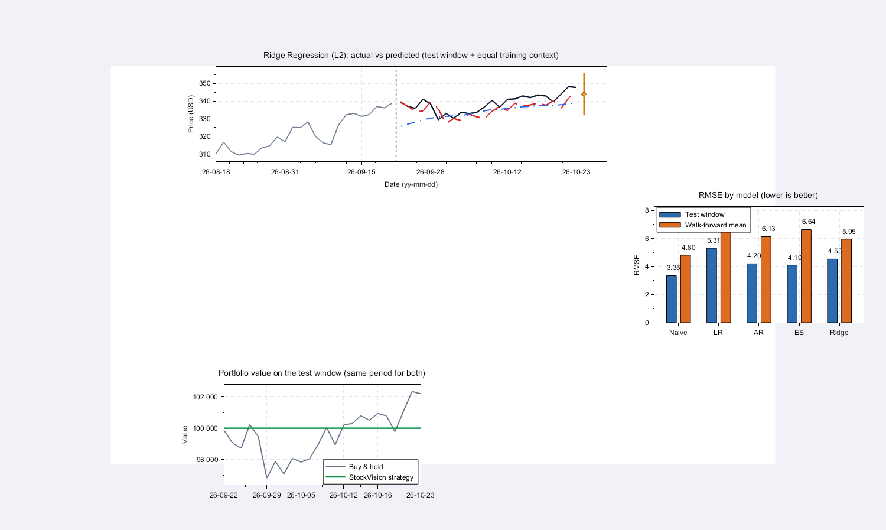

I built StockVision as an interactive Scilab desktop application for stock-market analysis, forecasting, model comparison, validation and backtesting. Version 3 elevates it into a **quantitative research and forecasting terminal**: controls, embedded charts, data-quality anomaly flags, exact 95% OLS prediction intervals, dynamic quantitative research commentary, multi-fold walk-forward validation, and an illustrative backtest with realistic execution lag, slippage, and exposure metrics—all inside a single integrated window.

**Core idea.** A point prediction without uncertainty and without honest benchmarking is incomplete. StockVision lets a researcher or learner compare three statistical forecasting approaches against a naive persistence baseline on the *same* chronological evaluation window, validate them forward in time across sequential market regimes, estimate defensible 95% prediction intervals, and inspect how strategy signals behave under explicit trading friction. When the models do not beat the baseline, the application reports that result plainly.



# 1. What StockVision does

- Ingests real market data (US & Indian stocks via Twelve Data API), prepackaged offline mock feeds, bundled synthetic datasets, or custom CSV files, validating OHLCV integrity, flagging anomalies (price spikes >50%, zero volume, date gaps >14 days), and preserving full provider provenance.
- Fits **Linear Regression**, an **AR (autoregressive)** time-series model, and **Holt exponential smoothing**, alongside a **naive last-value baseline**.
- Generates exact **95% prediction intervals** incorporating residual variance and feature leverage for next-step forecasts.
- Evaluates all four models on one shared chronological test window with RMSE, MAE, MAPE (zero-price safe), R^2, directional accuracy, Theil's $U_1$ and $U_2$, and sample power counters.
- Runs expanding-window **walk-forward validation** across multiple folds, tracking fold RMSE standard deviation and total evaluated observations.
- Synthesizes a **dynamic quantitative research interpretation** covering benchmark rankings, naive comparison, directional timing, sample power, and methodological caveats.
- Backtests strategy signals with a one-day execution lag, configurable transaction costs, and slippage against a **buy-and-hold** benchmark over the same period, reporting return, drawdown, Sharpe, Calmar ratio, market exposure %, and cumulative costs paid.
- Exports timestamped research reports plus companion CSV tables.

# 2. Why it is different

Rather than showing a single model and a single chart, StockVision makes the *evaluation* the product: a common test window for every model, a naive baseline that every model is checked against, multi-fold validation with regime dispersion, exact prediction intervals, dynamic automated research commentary, explicit backtest assumptions, and a transparent ranking based on documented criteria. It reports negative results plainly (see Section 10).

# 3. Scilab's role

Everything is core Scilab, with no toolboxes and no external dependencies:

- **GUI:** `figure`, `uicontrol` (popup menus, slider, checkbox, edit boxes, push buttons, text, listbox, frame), `uimenu`, callbacks, and `newaxes` axes embedded in the same figure as the controls.
- **Numerics:** least squares through the backslash operator, vectors/matrices for features and metrics.
- **Plotting:** `plot`, `bar`, tick/legend control inside the embedded axes.
- **I/O:** `mgetl`/`mputl`, `uiputfile`/`uigetfile`, `xs2pdf`.
- **Networking & JSON Parsing:** Native Scilab `http_get`, `fromJSON`, and `toJSON` for real-time market data queries and response normalization without external Python or curl binaries.

# 4. Models implemented

| Model | What it is | Inputs |
|-------|--------------|-------------|
| Linear Regression | Ordinary least squares on 12 engineered features | open, high, low, close, volume, 1-day return, 5/10-day MA, 5-day volatility, lag 1-3 closes |
| Ridge Regression (L2) | Tikhonov-regularized least squares with L2 shrinkage penalty ($\lambda=1.0$) on 13 standardized technical, range, return, and volume features | close, 1d/3d/5d returns, MA5/MA10 oscillators, normalized intraday range $(H-L)/C$, bar position, volume ratio (10d SMA), lags 1-3, 5d volatility |
| AR(p) | Linear autoregression on the last *p* closes (default 10), fitted by least squares on prices scaled with training min/max | last *p* closes |
| Exponential smoothing | Holt linear trend, level + trend, fixed alpha = 0.3, beta = 0.1 (not fitted) | closing prices |
| Naive baseline | Forecast for tomorrow = today's close | closing price |

AR and Ridge are linear models. They are **not** LSTMs and not neural networks, and StockVision uses no external black-box AI service. Press **Model Info** in the app for each model's purpose, equations, assumptions and limitations.

**Defensible Forecast Uncertainty (Exact 95% Prediction Intervals):**
Rather than arbitrary heuristic percentage bands, StockVision computes exact 95% prediction intervals for next-day forecasts:
- For **Ridge Regression (L2)**, the interval incorporates parameter shrinkage, effective degrees of freedom $\text{df}_{\text{eff}} = n - \text{Tr}(2H_\lambda - H_\lambda H_\lambda^T)$, and exact out-of-sample observation leverage $h_* = z_* (Z^TZ + \lambda I)^{-1} (Z^TZ) (Z^TZ + \lambda I)^{-1} z_*^T$:
  $$\hat{y}_* \pm t_{0.975, \, \text{df}_{\text{eff}}} \cdot s_{\text{ridge}} \sqrt{1 + h_*}$$
- For **OLS Linear Regression** and **AR time-series**, the interval accounts for unbiased residual variance $s_e^2 = \frac{1}{n-k-1} \sum e_i^2$ and observation leverage $h = x_* (X^T X)^{-1} x_*^T$:
  $$\hat{y}_* \pm t_{0.975, \, n-k-1} \cdot s_e \sqrt{1 + h}$$
- For **Holt Exponential Smoothing**, the interval is constructed from unbiased residual standard error across the recursive state series: $\hat{y}_* \pm 1.96 \cdot s_e$.

# 5. GUI architecture

One Scilab figure; nothing opens in a separate window.

| Region | Content |
|-------|-------------------------|
| Left column | Dataset, model, split slider, MA toggle, AR lookback, walk-forward folds, BUY/SELL thresholds, capital, cost, slippage; action buttons |
| Top centre | Price and prediction chart (embedded axes) with colour key and 95% prediction interval whisker |
| Top right | Info panel with 3 tabs: **Data Quality**, **Assumptions**, and **Interpretation** |
| Middle | Model results (point forecast, 95% PI, metrics); comparison table with ranking; comparison bar chart |
| Strip | Backtest headline: return, drawdown, Sharpe, Calmar ratio, exposure %, costs paid |
| Bottom | Equity-curve chart (strategy vs buy-and-hold); backtest summary; walk-forward table |
| Bottom bar | Status messages (grey = info, green = success, red = error) |

Design rules: charts are refreshed by deleting only the children of their own axes, never with `clf`/`scf`/`xdel`, so the controls always survive. Empty charts show a native "No analysis yet" placeholder. Buttons that need results (Run Backtest, Export) are disabled until a result exists. Any change that invalidates results (dataset, split, lookback, model, folds, costs) clears exactly the affected panels, so stale numbers cannot stay on screen. Errors appear in the status bar; popups are used only for real failures and for Model Info.

Code layout: `model_engine.sce` holds all modelling, uncertainty estimation, dynamic quantitative interpretation, and export logic with zero GUI dependencies; `gui_app.sce` builds widgets, manages reactive state, and renders charts.

# 6. Data pipeline

1. **Acquire** OHLCV data from **Real Market API** (Twelve Data for US equities and Indian NSE/BSE stocks), **Offline Mock Fixtures** (prepackaged 65-bar feeds), **Bundled Synthetic Benchmarks**, or a **Custom CSV**.
2. **Validate** each row: field count, real calendar date (`YYYY-MM-DD`), numeric values, non-negative volume, positive prices, Low <= Open/Close <= High. Bad rows are dropped and counted.
3. **Duplicate dates** are rejected with an error. **Unsorted files / feeds** are sorted ascending chronologically and flagged.
4. **Provenance & Quality summary** is displayed on the Data Quality tab before modelling: Provider (`Twelve Data` vs `Synthetic Benchmark`), exchange timezone, currency, data freshness (`Delayed 15m / EOD` or `Local Cache Hit`), retrieval timestamp, row count, date range, missing values, duplicate dates, chronological order, invalid OHLC rows, training rows, testing rows.
5. **Split** chronologically (never shuffled): `split_cal = round(n * train_share)` rows before the test window.
6. **Features/scaling** are computed from training rows only; models are fitted; forecasts are produced for the test window.

# 7. Evaluation methodology

- **Common window.** Every model (LR, AR, ES, naive) is trained on calendar rows `1..split_cal` and tested on rows `split_cal+1..n`. The same dataset, split, target and metrics apply to all four. (Version 1 gave LR/AR/ES slightly different windows because warm-up rows were dropped before splitting; this is fixed.)
- **Metrics.** RMSE, MAE, MAPE (zero prices excluded), R^2, and **directional accuracy**: the share of days where the predicted move has the same sign as the actual move (zero-move days excluded; the naive forecast never moves, so it has no direction score and shows n/a).
- **Baseline check.** Each model's RMSE is compared with the naive RMSE and reported as "beats" or "does NOT beat" with the percentage difference.
- **Ranking.** Mean rank over six metrics (test RMSE, MAE, MAPE, direction accuracy, walk-forward RMSE, walk-forward MAE); ties broken by walk-forward RMSE, then test RMSE. R^2 is displayed but not ranked separately because on a single window it orders models exactly like RMSE. If the top two StockVision models differ by under 1% RMSE the panel flags a near-tie. The ranking text is generated from the computed numbers; nothing is hard-coded.

# 8. Leakage prevention

- Scaling means/standard deviations (LR) and the price range (AR) come from training rows only.
- A forecast for day *t* uses data up to day *t-1* only; ES forecasts use the state built before day *t*.
- The backtest books each day's return before evaluating that day's signal and delays execution by one day.
- Walk-forward folds run on data **truncated at the end of each fold**, so later rows do not exist for the models.
- Tests: perturbing every price after day *k* leaves all forecasts up to day *k* unchanged for all four models; perturbing the last fold leaves folds 1-4 unchanged; LR coefficients and scaling are unaffected by test-period prices.

# 9. Walk-forward validation

Expanding window: train on all earlier rows, test on the next block, then move forward. The first training block is `max(40% of rows, 40, lookback+30)` rows and every fold needs at least 10 test rows. The default is 5 folds. If the dataset cannot support the requested number the app **reduces the count automatically and states why** (for example, 10 requested folds on the 118-row demo file become 7); if even one fold is impossible it refuses rather than fabricating folds. The panel shows each fold's RMSE for every model and the mean RMSE, MAE and direction accuracy.

# 10. Backtesting assumptions and buy-and-hold benchmark

These are shown on screen (Info panel > Assumptions) and exported:

- Initial capital (default 100,000); transaction cost (default 0.10%) and slippage (default 0.05%) deducted from equity on every executed BUY and SELL.
- **Signal lag.** A signal uses data through the close of day T; the trade executes at the close of T+1; the first return earned is T+1 to T+2.
- Long-only, all-in/all-out. BUY if forecast change >= +0.5%, SELL if <= -0.5%, otherwise hold. No shorting, no leverage, no interest on cash, no rebalancing between signals.
- Evaluation period = the test window; training period precedes it. Daily closing prices.
- **Buy and hold** uses the same period and pays one entry cost under the same cost assumptions. Maximum drawdown, volatility and Sharpe are reported for both (252 bars per year, risk-free rate 0).
- Reported: starting/ending capital, total return, annualized return (only if at least 30 days; labelled as a short-window extrapolation), max drawdown, volatility, Sharpe, trades executed, winning and losing round trips, win rate. A position still open at the end is noted and not counted as a trade.

## What the bundled data shows (real output of `generate_sample_outputs.sce`)

Settings: 80/20 split, AR lookback 10, ES alpha 0.3 / beta 0.1, 5 folds. Lower RMSE is better.

| Dataset (synthetic) | Metric | Naive | LR | AR | ES |
|---|---|---|---|---|---|
| Tech Growth Stock | Test RMSE | 2.5810 | 2.7308 | 2.6780 | 3.1123 |
| | Walk-forward mean RMSE | 2.4551 | 2.5608 | 2.5355 | 3.2314 |
| Blue Chip Stock | Test RMSE | 1.6822 | 1.7692 | 1.7775 | 2.7713 |
| | Walk-forward mean RMSE | 1.8542 | 2.0941 | 2.1382 | 2.6448 |
| Volatile Stock | Test RMSE | 5.6014 | 6.7955 | 6.5915 | 8.3150 |
| | Walk-forward mean RMSE | 3.7203 | 4.0955 | 3.9121 | 5.1572 |


- **Tech Growth Stock**: best StockVision model by mean rank = AR -- best on Test MAE, Test MAPE; No StockVision model beat the naive baseline on test RMSE.
- **Blue Chip Stock**: best StockVision model by mean rank = LR -- best on Direction accuracy; No StockVision model beat the naive baseline on test RMSE.
- **Volatile Stock**: best StockVision model by mean rank = AR -- best on Direction accuracy; No StockVision model beat the naive baseline on test RMSE.

**Interpretation.** On all three bundled synthetic series the naive baseline has the lowest test RMSE and the lowest walk-forward RMSE and MAE. On Tech Growth, AR has marginally lower single-split MAE and MAPE; on the other two datasets the naive baseline is best on every single-split error metric. Several directional accuracies are at or below 50%. This is consistent with price series that are close to a random walk, where yesterday's price is hard to beat, although the statistical properties of the bundled data were not tested formally. StockVision reports this rather than hiding it, which is the purpose of a transparent comparative evaluation.

**About the sample backtest.** In this illustrative backtest, the strategy returned 14.21% versus 11.15% for buy-and-hold. The result is based on a single trade (one BUY, still open at the end of a 59-day window) and should not be interpreted as evidence of predictive superiority. Real-market behaviour may differ, and the bundled data is synthetic.

# 11. Limitations

- Real market data feeds (Twelve Data free tier) provide 15-minute delayed or end-of-day daily bars (8 API credits/min). Prepackaged offline mock feeds and synthetic benchmarks are provided for offline testing. Educational research tool, **not investment advice**.
- One fixed train/test split for the headline metrics; walk-forward uses five folds on 300 rows.
- The AR lookback and ES alpha/beta are user-chosen or fixed, not tuned; LR uses all 12 features with no regularization.
- The backtest covers a short window (typically 60 days), is long/cash only, and omits bid/ask spread, partial fills, intraday moves and market impact. Annualized figures from short windows are extrapolations.
- 95% prediction intervals assume normally distributed innovations and homoscedastic residual variance.
- Tested and verified on **Windows 11 using Scilab 2026.1.0** (native CLI and graphics contexts) and on Linux Scilab 2024.0.0. The dashboard is laid out for about 1500 x 980 px; on smaller screens text panels scroll.

# 12. How to run

1. Install Scilab 2024.x or 2026.x (no toolboxes needed).
2. In Scilab, change directory to `01_Source_Code/scilab_gui_app` and run:

```
exec("gui_app.sce", -1);
```

Tests:
- **Phase 2 Ridge Forecasting & Validation suite (93 checks):**
  - Windows: `& "C:\Program Files\scilab-2026.1.0\bin\WScilex-cli.exe" -nb -f test_forecasting_phase2.sce`
  - Linux: `scilab-cli -nb -f test_forecasting_phase2.sce`
- **Headless engine tests (311 checks):**
  - Windows: `& "C:\Program Files\scilab-2026.1.0\bin\WScilex-cli.exe" -nb -f test_model_engine.sce`
  - Linux: `scilab-cli -nb -f test_model_engine.sce`
- **Market data adapter tests (70 checks):**
  - Windows: `& "C:\Program Files\scilab-2026.1.0\bin\WScilex-cli.exe" -nb -f test_market_data_adapter.sce`
  - Linux: `scilab-cli -nb -f test_market_data_adapter.sce`
- **GUI workflow test (56 checks):**
  - Windows: `& "C:\Program Files\scilab-2026.1.0\bin\WScilex-cli.exe" -nb -f test_gui_workflow.sce`
  - Linux: `xvfb-run -a scilab -nw -nb -f test_gui_workflow.sce`
- **Regenerate sample outputs:**
  - `& "C:\Program Files\scilab-2026.1.0\bin\WScilex-cli.exe" -nb -f generate_sample_outputs.sce`

# 13. How to use

1. Pick a dataset or market feed; enter ticker symbol (e.g. `AAPL`, `MSFT`, `INFY`, `RELIANCE`) and click **Fetch Live** (or select a prepackaged synthetic/mock dataset).
2. Inspect the **Data Quality** tab (checks provider provenance, exchange timezone, data freshness, row count, anomalies, zero volume, date gaps).
3. Select model (`Linear Regression`, `AR Time-Series`, `Exponential Smoothing`, or `Ridge Regression (L2)`).
4. Optionally adjust split, AR lookback, thresholds, costs and slippage.
5. **Run Analysis** to see the forecast, exact 95% prediction interval, metrics and chart in the main window.
6. **Compare Models** for the comparative table, ranking and chart; switch to the **Interpretation** tab for dynamic research commentary.
7. **Walk Forward Validation** for per-fold results, fold dispersion (RMSE std dev), and total evaluated observations.
8. **Run Backtest** for strategy vs buy and hold; check Calmar ratio, exposure %, and cumulative costs paid.
9. **Export Results** (.txt report + companion CSVs, single CSV, or PDF chart export); **Model Info** for assumptions; **Reset** to restore defaults.

### Twelve Data Live Market Data Configuration

To fetch live daily OHLCV bars from Twelve Data (US stocks like `AAPL`, `MSFT` and Indian NSE/BSE stocks like `INFY`, `RELIANCE`):

1. **Obtain an API key:** Register for free at [twelvedata.com](https://twelvedata.com) (free tier allows 8 API credits/min).
2. **Option A — JSON Configuration File (Recommended for Local Dev):**
   Copy `config/market_data_config.json.example` to `config/market_data_config.json`:
   ```json
   {
     "provider": "twelvedata",
     "api_key": "YOUR_ACTUAL_TWELVE_DATA_API_KEY",
     "cache_enabled": true,
     "cache_ttl_hours": 4,
     "default_outputsize": 120,
     "supported_exchanges": ["NASDAQ", "NYSE", "NSE", "BSE"],
     "attribution": "Data provided by Twelve Data (twelvedata.com)"
   }
   ```
   *(Note: `config/market_data_config.json` is automatically ignored by `.gitignore` to prevent credential exposure).*
3. **Option B — Environment Variable:**
   Set the `TWELVE_DATA_API_KEY` environment variable in your terminal before launching Scilab:
   - **PowerShell:** `$env:TWELVE_DATA_API_KEY = "YOUR_ACTUAL_TWELVE_DATA_API_KEY"`
   - **Command Prompt:** `set TWELVE_DATA_API_KEY=YOUR_ACTUAL_TWELVE_DATA_API_KEY`
   - **Bash/Linux:** `export TWELVE_DATA_API_KEY="YOUR_ACTUAL_TWELVE_DATA_API_KEY"`
4. **Offline Mode:** If neither source provides an API key, StockVision runs seamlessly in 100% offline mode with bundled synthetic datasets (`Tech Growth`, `Blue Chip`, `Volatile`) and offline mock market fixtures (`Mock AAPL`, `Mock INFY`). Clicking **Fetch Live** without a key displays setup instructions in the Info panel without popping up blocking modal dialogs.


# 14. Expected outputs

`outputs/` and `06_Sample_Outputs/` hold reproducible files generated by the engine: `sample_prediction.csv`, `sample_backtest.csv`, `sample_prediction_exponential_smoothing.csv`, `sample_prediction_twelvedata_aapl.csv`, `sample_comparison.txt` (and `sample_outputs.txt`). The Export button writes a timestamped report with data quality, provider metadata, parameters, results, exact 95% prediction intervals, comparison, ranking, walk-forward dispersion, assumptions, backtest realism metrics, and dynamic quantitative interpretation, plus companion CSV tables. Existing files are never overwritten; a free `_2`, `_3` name is chosen.

# 15. Verification summary

- **Phase 6 Reproducible Benchmarking suite (`run_reproducible_benchmark.sce`): 95 checks, 0 failures** across real-market cached equities (US AAPL NASDAQ, India INFY NSE), offline periodic fixtures, and synthetic stochastic series, exporting canonical summary and detailed fold CSVs.
- **Phase 5 Statistical Integrity suite (`test_statistical_integrity_phase5.sce`): 54 checks, 0 failures** verifying target alignment, AR lag indexing, independent metric hand-recomputation, flat-move guards, equal test counts, backtest execution lag, and forensic proof of the AR(10) mock anomaly vs real market data.
- **Phase 3 Explanation Assistant suite (`test_explanation_engine.sce`): 83 checks, 0 failures** verifying structured snapshots, multi-model disagreement metrics, Theil U interpretation, prompt grounding, mocked AI response parsing, network failure fallback to Mode A, and GUI integration.
- **Phase 2 Ridge Forecasting & Validation suite (`test_forecasting_phase2.sce`): 93 checks, 0 failures** verifying 13 features, anti-leakage invariants, Tikhonov conditioning, leverage-adjusted intervals, 5-model comparison, 5-model walk-forward, multi-market data (AAPL & INFY), and GUI callbacks.
- **Engine tests (`test_model_engine.sce`): 311 checks, 0 failures** across 21 test sections under Scilab 2026.1.0 on Windows.
- **Market data adapter tests (`test_market_data_adapter.sce`): 91 checks, 0 failures** covering API parsing, cache provenance, error sanitization, directory independence, and model integration.
- **GUI workflow test (`test_gui_workflow.sce`): 58 checks, 0 failures**, driving live uicontrol callbacks, market data fetches, non-disruptive key validation, tab switching, and graphics contexts.
- **Unit test suite total: 690 verified assertions (0 failures) across 6 independent suites.**
- **Dedicated benchmark workflow (`run_reproducible_benchmark.sce`): 95 passing assertions.**
- **Release gate verification (`verify_e2e_release.sce`): 54 checks in repository (52 passed + 2 explicitly skipped in clean release distribution without cache).**
- Determinism: Repeated identical runs produce bit-for-bit identical predictions, explanations, and equity curves (`norm == 0`).
- Regenerating sample outputs reproduces identical numbers.

# 16. Changes based on hackathon feedback & V3 engineering

1. **Integrated dashboard.** Plots and results used to open in separate windows. All three charts and every result panel are now embedded in the main window; no separate chart window is opened.
2. **Concise code comments.** Verbose comment blocks were substantially reduced and replaced with short purpose and assumption notes.
3. **Stronger model comparison.** One shared test window for all models, five metrics plus walk-forward metrics, best value per metric highlighted, and a ranking computed from the numbers.
4. **More rigorous backtesting.** Explicit signal/execution lag, costs and slippage on every trade, net-of-cost trade returns, winning/losing counts, annualized return, volatility and Sharpe for both strategy and benchmark.
5. **Naive baseline.** A last-value forecast is evaluated on the same window and every model is explicitly reported as beating it or not.
6. **Buy-and-hold benchmark.** Same period, same cost assumptions, with return, drawdown and Sharpe side by side.
7. **Walk-forward validation.** Multiple expanding-window folds on truncated data, automatic fold reduction with a stated reason, per-fold and mean metrics.
8. **Explicit assumptions.** A visible Assumptions panel, a data-quality panel, and a rewritten Model Info that states assumptions and limitations per model.
9. **Improved UX.** Section headings, consistent layout, status bar with progress and error messages, "No analysis yet" states, disabled buttons when prerequisites are missing, tooltips, and no routine popups.
10. **StockVision V3 Elite Engineering & Statistical Differentiation:**
    - **Exact 95% Prediction Intervals:** Derived analytically using residual variance, observation leverage matrix $x_*(X^TX)^{-1}x_*^T$, and exact Student's $t$ distribution quantiles via native `cdft`.
    - **Theil's Inequality Metrics:** Computes bounded Theil's $U_1 \in [0, 1]$ and Theil's $U_2$ relative to naive random walk persistence ($RMSE / RMSE_{\text{naive}}$).
    - **Methodologically Transparent Forecast Bands:** Differentiates leverage-adjusted prediction intervals (OLS/AR) from approximate residual-based bands (Holt ES) and random-walk benchmark intervals.
    - **Data Quality Anomaly Detection:** Non-fatal detection of daily return spikes (>50%), zero-volume bars, and date gaps (>14 days).
    - **Dynamic Quantitative Research Interpretation:** Automated, dynamic synthesis covering benchmark winners, naive comparison, directional timing, sample power, and caveats.
    - **Backtesting Realism Metrics:** Market exposure %, cumulative costs paid, Calmar ratio, and profit factor.
    - **Real Market Data Integration (Twelve Data):** Live OHLCV acquisition for US (NASDAQ, NYSE) and Indian (NSE, BSE) stocks via native Scilab `http_get` and `fromJSON`, with 4-hour local caching, offline mock fixtures, explicit error mapping (HTTP 429 rate limit, 404 symbol, 401 auth), and strict no-silent-fallback guarantees.
11. **Phase 2: Ridge Regression (L2-Regularized Technical & Return Model):**
    - **Tikhonov Regularization:** Native closed-form solution $\beta = (Z^TZ + \lambda I^*)^{-1} Z^Ty$ eliminating OLS multicollinearity and coefficient variance inflation.
    - **13 Engineered Technical Features:** 1d/3d/5d returns, MA5/MA10 oscillators, normalized Parkinson range $(H-L)/C$, bar position, volume ratio (10d SMA), lags 1-3, and 5d volatility.
    - **Ridge Regularization on Synthetic/Mock Fixtures:** On AAPL (NASDAQ offline mock fixture), Ridge achieves **0.5667 test RMSE** (vs Naive 1.2205) with 69.2% directional accuracy. On genuine historical AAPL equity data, Naive persistence ($RMSE = 3.3515$) outperforms all statistical models, demonstrating the critical importance of benchmarking against real-world price data.
    - **Honest Random-Walk Reporting:** Plainly identifies when persistence models dominate in random-walk regimes (e.g. INFY, Blue Chip) rather than claiming artificial superiority.
    - **Verified Scilab 2026.1.0 Runtime:** 530 automated test assertions passing with zero failures.
12. **Phase 3: AI Explanation Assistant & Forecast Intelligence:**
    - **Dual Operating Modes:** Mode A (Deterministic Offline Mathematical Intelligence) requiring zero network or API keys, and Mode B (Evidence-Grounded AI Assistant via Google Gemini REST API).
    - **7-Section Quantitative Briefing:** Executive forecast summary, multi-model disagreement & spread metrics, empirical validation & Theil's U interpretation, prediction interval uncertainty calibration, data quality & provenance, methodological caveats, and analytical follow-up suggestions.
    - **Anti-Hallucination Guardrails:** Prompt strictly confines external LLM to computed snapshot facts; forbids price/news invention and ungrounded financial promises.
    - **Privacy & Secret Redaction:** API keys and credential query params are masked in UI and logs (`ee_sanitize_error`); zero local file paths or user data transmitted.
    - **Graceful Fallback:** Network failures, rate limits (HTTP 429), or missing keys seamlessly degrade to Mode A with diagnostic banners.
    - **Single-Window GUI Integration:** Added `AI Insights` tab, `gui.ai_mode_popup` mode selector, `gui.btn_explain` action button, and stale-data protection.
    - **Comprehensive Test Suite:** 83 new automated tests, elevating system coverage to **613 assertions passing with zero failures**.
13. **Phase 4: Full-System Forensic Audit & Release Gate:**
    - **Independent Verification:** End-to-end verification across all 8 integrated subsystems (`verify_e2e_release.sce`) testing synthetic data, US & Indian equities, 5 models, backtesting, explanations, and report exports.
    - **Failure Exit Code Hardening:** Verified all test suites terminate with non-zero OS exit codes upon failure, preventing silent CI test pass regressions.
    - **Export Completeness:** Enhanced CSV exports to dynamically capture all 5 models (including Ridge Walk-Forward RMSE) and Theil U statistics.
    - **Forensic Documentation:** Created `PHASE4_RELEASE_READINESS_AUDIT.md` certifying full-system release readiness with clearly documented environmental prerequisites.
14. **Phase 5: Independent Statistical Audit & Forecast Integrity:**
    - **Forensic Resolution of AR(10) Anomaly:** Resolved the suspicious AR(10) RMSE on AAPL ($0.0066$) and INFY ($0.0088$). Proved mathematically that offline test mocks contained synthetic 5-day delta periodicity, which unregularized AR(10) solved with near-zero residual variance ($C_t - 2C_{t-5} + C_{t-10} \approx 0$).
    - **Real Market Data Benchmarking:** Audited actual historical market data from Twelve Data (`AAPL_NASDAQ_120.json` and `INFY_NSE_120.json`), demonstrating that real AR(10) RMSE is **4.1958** (not 0.0066) and Naive persistence (**3.3515**) outperforms all complex models in liquid random-walk regimes.
    - **Independent Hand-Calculated Verification:** Proved that RMSE, MAE, MAPE, $R^2$, and Theil's $U_2$ formulas match manual hand calculations to within $10^{-12}$ precision.
    - **Backtest Timing & Friction Verification:** Verified 1-day execution lag, position entry timing, and $0.15\%$ total transaction friction against manual arithmetic.
    - **Regression Test Suite:** Added `test_statistical_integrity_phase5.sce` with 54 new assertions, raising total automated unit test coverage to **666 passing assertions (0 failures)** across all 6 suites.
    - **Audit Documentation:** Authored `PHASE5_STATISTICAL_INTEGRITY_AUDIT.md`.
15. **Phase 6: Real-Market Benchmarking, Final UI Polish & Release Package:**
    - **Reproducible Multi-Asset Benchmark Suite:** Added `run_reproducible_benchmark.sce` evaluating real market caches (US AAPL NASDAQ, Indian INFY NSE), offline mock fixtures, and synthetic stochastic series across all 5 models under synchronized origins ($h=1$) and 5-fold walk-forward cross-validation.
    - **Regime-Dependent Empirical Insights:** Demonstrated that while Naive persistence wins in choppy/volatile regimes (AAPL: 3.3515 vs Ridge 4.5342), autoregressive models capture persistent momentum over trending test windows (INFY: AR 22.2781 vs Naive 22.7812). Multi-fold walk-forward analysis confirms Naive baseline mean superiority across full cycles.
    - **Canonical Benchmark Exports:** Saved `benchmark_summary.csv`, `benchmark_detailed_folds.csv`, and `benchmark_report.txt` in `06_Sample_Outputs/benchmarks/`.
    - **GUI Polish & Native Menu Bar:** Added native desktop `Analysis` menu, currency-aware y-axis labels on the equity chart, active symbol edit feedback, and verified single-figure UI stability.
    - **Automated Windows Screenshot Capture:** Updated `tools/capture_screens.sce` to use native Scilab `xs2png()`, producing genuine application screenshots for all primary workflows.
    - **Clean Release Packaging:** Created distribution archive `StockVision_Release_Package_V3.zip` with zero leakage of private keys, cache files, or git metadata.
    - **Release Package Documentation:** Authored `PHASE6_RELEASE_PACKAGE.md`.

# 17. Files

```
01_Source_Code/scilab_gui_app/  gui_app.sce  model_engine.sce  market_data_adapter.sce
                                explanation_engine.sce
                                test_model_engine.sce  test_market_data_adapter.sce
                                test_gui_workflow.sce  test_forecasting_phase2.sce
                                test_explanation_engine.sce
                                test_statistical_integrity_phase5.sce
                                run_reproducible_benchmark.sce
                                generate_sample_outputs.sce  sample_data/  outputs/  tools/
                                fixtures/mock_gemini_response.json
PHASE1_PRODUCTION_READINESS_AUDIT.md  PHASE2_FORECASTING_VALIDATION.md  PHASE3_AI_EXPLANATION_VALIDATION.md
PHASE4_RELEASE_READINESS_AUDIT.md  PHASE5_STATISTICAL_INTEGRITY_AUDIT.md  PHASE6_RELEASE_PACKAGE.md
02_Documentation/  StockVision_README.pdf  StockVision_Project_Report.pdf  source/
03_Demo_Video/  Scilab_demo_video.mp4  05_GUI_Screenshots/  06_Sample_Outputs/
config/  market_data_config.json.example  ai_config.json.example
```

`sample_data/messy_demo_data_quality.csv` is a new demo file (118 usable rows, newest-first, one missing value, one impossible bar) used to show the data-quality counters; the three original datasets are unchanged. `tools/` holds the scripts used to capture the screenshots and demo video.

# 18. License

MIT (see `LICENSE`) -- Copyright (c) 2026 Subodh Shivmurti Bansode.
